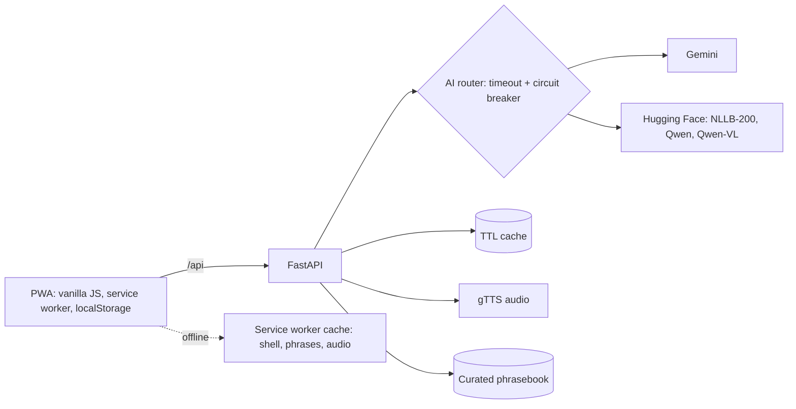

# ನಮ್ಮ ಕನ್ನಡ · Namma Kannada

**Kannada for everyday life.** Not a course but a pocket tool: someone new to Karnataka can *use* Kannada in an auto, market, clinic, office or restaurant within minutes, then learn it properly with spaced repetition.

## Why it stands out
| Problem | What we built |
|---|---|
| Learners need words *right now*, not lessons | **Situation-first phrasebook** with a **📣 Show to someone** full-screen mode (hold your phone up to the driver) |
| Apps die without data | **Offline-first PWA**: installable, works with no signal, downloadable audio pack |
| Reading Kannada script is the barrier | Roman-letter pronunciation everywhere, **voice input**, **sign/menu scanner** |
| Phrasebooks don't teach conversation | **AI roleplay** with 5 locals; you see how to say *your own* sentence in Kannada |
| Learners forget | **Leitner spaced repetition**, XP, levels, streaks |
| AI demos break on stage | **Multi-provider failover** (Gemini, then Hugging Face NLLB/Qwen) with a circuit breaker and offline phrasebook fallback |

## Architecture


**Engineering highlights**
- Provider router with per-call timeout, automatic failover and a circuit breaker (a failing provider is skipped for 60 s).
- Graceful degradation: AI down, so the curated phrasebook answers; offline, so a local fuzzy match runs in the browser.
- Security: strict CSP (no inline scripts or styles, no third-party requests), `nosniff`, no-referrer, per-IP sliding-window rate limits, input length caps, image magic-byte and size checks, injection-aware system prompt, non-root Docker user.
- Privacy: no accounts, no tracking; progress stays on the device.
- Ops: `/api/health` (provider status), `/api/metrics`, structured JSON request logs with request IDs, Docker healthcheck, CI.
- 18 backend tests (failover, breaker, cache, rate limiting, validation, upload checks) using deterministic stub providers.

## Run locally
```powershell
python -m venv .venv ; .venv\Scripts\activate
pip install -r requirements.txt
# put your key in a file named .env (copy .env.example): GEMINI_API_KEY=your-key
python -m uvicorn app.main:app --reload
```
Open http://localhost:8000, then check http://localhost:8000/api/diagnose to confirm each AI key works (shows the exact reason if not). Free keys: [Gemini](https://aistudio.google.com/apikey), [Hugging Face](https://huggingface.co/settings/tokens) (Read). Tests: `pip install -r requirements-dev.txt` then `python -m pytest -q`.

## Deploy
- **Render:** push to GitHub, New, Blueprint (uses `render.yaml`), then add `GEMINI_API_KEY` / `HF_TOKEN`.
- **Hugging Face Spaces (Docker):** create a Docker Space, push this repo, set `app_port: 7860` in the Space README header and `PORT=7860` as a variable, add the token as a secret.
- **Anywhere:** `docker build -t nk .` then `docker run -p 8000:8000 -e GEMINI_API_KEY=... nk`.
- HTTPS is required for install, microphone and camera; Render and Spaces provide it.

## 3-minute demo script
1. **(20s) Hook:** "You just landed in Bengaluru. Your auto driver speaks only Kannada." Open **Phrases > Auto & Bus**, tap **📣 Show**; it plays the phrase aloud.
2. **(30s) Voice:** **Translate**, tap 🎤, say "Where can I get filter coffee?", play the result slowly.
3. **(40s) Talk:** start the vendor roleplay, tap a suggested reply, point out the Kannada and Roman-letter pronunciation.
4. **(30s) Scan:** photograph a Kannada sign and show the translation.
5. **(30s) Offline:** turn on airplane mode. The app still opens and saved audio still plays (Home > "Save audio for offline" beforehand).
6. **(30s) Engineering:** show `/api/health`, remove the primary key to demonstrate failover, mention tests and CI.

## Known limitations
- AI translation and OCR can be imperfect; the curated phrasebook is the trusted core. Have the 40 phrases reviewed by a native speaker before launch.
- Roman-letter pronunciation for AI output is an automatic approximation.
- Voice input uses the browser's speech recognition (Chrome/Edge); Kannada accuracy varies.
- Rate limiter and cache are in-memory (single process). For several instances, move them to Redis.

## Roadmap
Native-speaker review workflow, more scenarios (hospital, government office, rentals), dialect notes (Mysuru, Dharwad, Mangaluru), WhatsApp bot, teacher dashboard.
